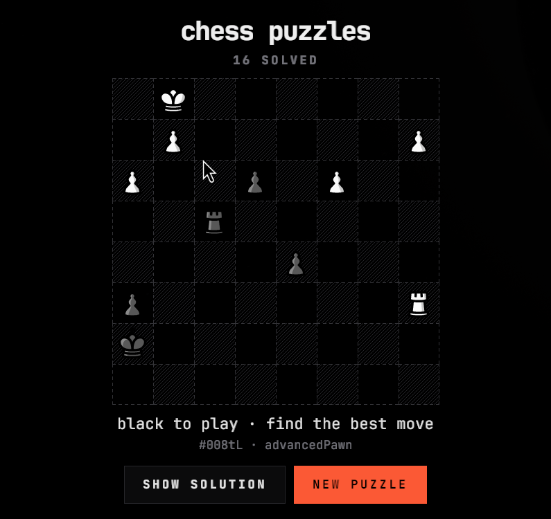

# chess-puzzles-bevy

Native chess puzzle trainer built with Rust + [Bevy](https://bevyengine.org)
0.20: solve [Lichess](https://lichess.org) puzzles at a target ELO on a
monochrome, terminal-styled board.



## Features

- **Adaptive difficulty**: a hidden target ELO (600–2500) follows your
  results. Each puzzle settles once: a clean solve +8, a solve with wrong
  tries −4, showing the solution or skipping mid-puzzle −12. It settles where
  you solve about two in three puzzles cleanly. A puzzle's rating is shown
  only after it's settled. Puzzles are served from a local cache, picking the
  one closest to the target while avoiding the ~80 most recently served.
- **Offline cache** seeded from the
  [Lichess puzzle database](https://database.lichess.org/) — popular puzzles
  bucketed across the whole rating range. `pick.sh` falls back to a live
  Lichess fetch and appends to the cache, so it grows on its own.
- **Click-click input**, judged against the puzzle's solution list (no move
  generator — the solution is the only judge). Opponent replies auto-play
  after 650ms; "Show solution" walks the line at 650ms a move; wrong attempts
  flash the target square; promotions accepted on the first four characters.
  Puzzles are fetched off the main thread.
- **Pixel-exact board**, CPU-painted to a texture with one texel per physical
  pixel at any window size and display scale: whole-pixel squares, 1px dashed
  outlines, and pieces rendered from SVG at their exact size (no resampling).
  Pure black, diagonal-hatched light squares, one accent (`#ff5a36`) for the
  last move, selection ring, wrong attempts and move arrows; monochrome
  user-drawn arrows (**shift+drag**), cleared by clicking an empty square.
- **Low power**: event-driven. It renders only while something changes
  (input, a countdown, a fade, a fetch) and otherwise sleeps.
- Board flips so the side to move sits at the bottom. Keyboard: `n` new
  puzzle, `s` show solution, `f` flip board.

## Run

```sh
cargo run --release
```

Piece art (`assets/pieces/*.svg`) and the font (JetBrains Mono, variable
weight) ship in `assets/`. `scripts/pick.sh` needs `curl` and `jq`.

The puzzle cache and state live under `~/.local/state/omarchy/`
(`chesspuzzles/cache.jsonl`, `settings/chesspuzzles-bevy.json`). Point
`CHESS_PUZZLES_PICK` at your own picker script to change where puzzles come
from; it just needs to print one JSON record per invocation:

```json
{"id":"…","fen":"…","rating":2205,"themes":[…],"solution":["h5h7",…]}
```

## Layout

```
src/main.rs    Bevy app: window, UI, input, async fetch, board placement, idle
src/state.rs   puzzle state machine (phases own their countdowns), persistence
src/model.rs   FEN parsing + UCI move application (castling, EP, promotion)
src/paint.rs   CPU board painter (hatch, dashes, arrows, piece blitting)
src/pieces.rs  SVG piece art, rasterized with resvg at the board's cell size
src/theme.rs   colour tokens
src/paths.rs   where assets/ and scripts/ are found
scripts/pick.sh  serve one puzzle near a target ELO from the cache
scripts/seed.py  one-off cache seeding from the Lichess puzzle database
```

## Credits

- Pieces: [caliente](https://github.com/avi-0/caliente) by avi-0
  (CC BY-NC-SA 4.0), the SVGs as shipped by Lichess. No legal-move engine:
  the puzzle solutions come from Lichess's public puzzle database (CC0).
- Font: [JetBrains Mono](https://github.com/JetBrains/JetBrainsMono)
  (OFL 1.1, `assets/fonts/OFL.txt`).
- The Quickshell/QML twin of this app — the same trainer as an Omarchy bar
  panel:
  **[mtib/chess-puzzles-qml](https://github.com/mtib/chess-puzzles-qml)**.

## License

MIT for the code; the bundled pieces and font keep their own licenses (see
credits).
